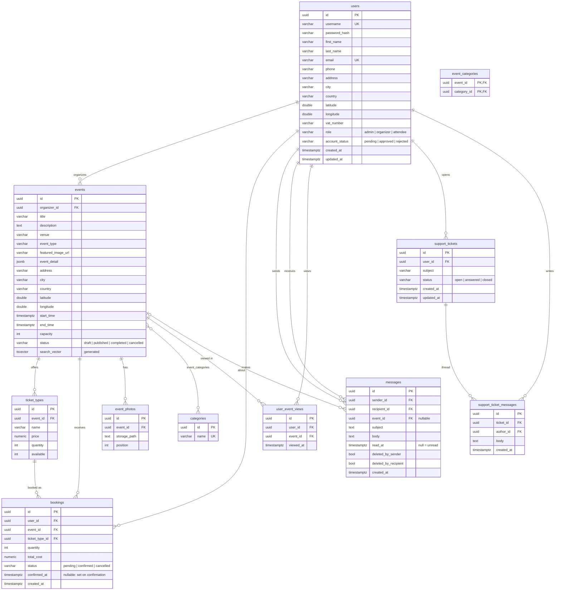

# Database design

PostgreSQL 16. The schema is owned by the GORM models in
`backend/internal/repository/postgres/models.go` and applied by
`backend/internal/db/automigrate.go` at every backend start: `AutoMigrate`
creates/alters the tables, then the file adds what GORM cannot express —
CHECK constraints, foreign keys with explicit `ON DELETE` rules, the generated
full-text column, and the indexes. The DTD in the assignment (§7) was the
starting point: each DTD element became a table or a column, repeated
elements (`Category+`, `TicketType+`, `Booking*`, `Photo*`) became child tables.

## ER diagram



## Tables

### `users`
One row per account, all roles. `role` is a single value (`admin`, `organizer`,
`attendee`) chosen at registration and changeable by the admin; the guest role
is never stored. `account_status` implements the approval flow of §2–§4.
Address fields and `latitude`/`longitude` are the "στοιχεία διεύθυνσης και
γεωγραφικής τοποθεσίας" of §2. Passwords are bcrypt (cost 12) and never leave
the repository layer.

### `events`
The `<Event>` element. `event_type` is the DTD's `<EventType>`; the many-valued
`<Category>` lives in `event_categories`. `event_detail` (JSONB) holds optional
presentation extras (artists, useful info, occurrences) that are not part of the
assignment's DTD and therefore not part of the export. `search_vector` is a
stored generated column: `to_tsvector('greek', title ‖ description ‖ venue ‖ city)`,
indexed with GIN — this is what `q=` searches (§8). CHECKs: `capacity ≥ 0`,
`end_time ≥ start_time`, `status` in the four lifecycle states.

### `categories`, `event_categories`
Taxonomy plus the M:N join. Categories are created on demand when an organizer
types a new name; `event_categories.category_id` is `ON DELETE RESTRICT`, so a
category in use cannot vanish.

### `ticket_types`
`<TicketType>`: `quantity` is the total, `available` the remaining seats.
CHECKs: `price ≥ 0`, `quantity ≥ 0`, `0 ≤ available ≤ quantity`; unique
`(event_id, name)`. The service layer enforces the §7 rule
`Σ quantity ≤ events.capacity` on every create/update.

### `bookings`
`<Booking>`: who, which event, which ticket type, how many, total, status.
`total_cost` is computed server-side. `FK … ON DELETE RESTRICT` on all three
references: a booked event, ticket type or user cannot be hard-deleted, which is
why cancellation is a status change (§7γ). The seat decrement is one atomic
statement in a transaction with the insert:

```sql
UPDATE ticket_types SET available = available - $n
WHERE id = $id AND available >= $n;   -- 0 rows affected ⇒ capacity exceeded
```

### `messages`
The mailbox of §10. One row per message; the sender's "sent" folder and the
recipient's "inbox" are the same row filtered on `sender_id` / `recipient_id`.
Each side deletes independently (`deleted_by_sender`, `deleted_by_recipient`),
so a message disappears from one folder without touching the other.
`read_at IS NULL` is the "new message" indicator; a partial index
`(recipient_id) WHERE read_at IS NULL` serves the unread count, which is also
cached in Redis (`nexustickets:unread:<user_id>`). `event_id` (nullable,
`ON DELETE SET NULL`) links a message to the event it is about — cancellation
notices and organizer broadcasts always set it.

### `support_tickets`, `support_ticket_messages`
Support is deliberately not the mailbox: a ticket has one owner (`user_id`),
is worked by whichever administrator replies, and keeps its thread in
`support_ticket_messages` (author = the user or an admin). `status` is a CHECK
over `open | answered | closed`; `updated_at` moves on every reply so the queue
sorts by recent activity. Opening a ticket inserts the ticket and its first
message in one transaction.

### `event_photos`
`<Media><Photo>`: files under `MEDIA_STORAGE_PATH/<event_id>/`, served from
`/uploads/media`, ordered by `position` (unique per event).

### `user_event_views`
Implicit feedback for the recommender (§13): one row each time a signed-in user
opens an event page. Together with confirmed bookings it forms the training
matrix (view = 1.0, booking = 3.0).

## Indexes

- `events`: `(status, start_time)` for listings, `city`, `organizer_id`, `event_type`, GIN on `search_vector`
- `bookings`: `(user_id, created_at DESC)`, `(event_id, created_at DESC)`, `ticket_type_id`
- `messages`: `(sender_id, created_at DESC)`, `(recipient_id, created_at DESC)`, partial unread index, `event_id`
- `user_event_views`: `(user_id, viewed_at DESC)`, `(event_id, viewed_at DESC)`
- `support_tickets`: `(user_id, updated_at DESC)`, `(status, updated_at DESC)`; `support_ticket_messages(ticket_id, created_at)`
- unique: `users.username`, `users.email`, `categories.name`, `ticket_types(event_id, name)`, `event_photos(event_id, position)`

## Redis

| Key | Use |
|---|---|
| `refresh:<jti>` | valid refresh tokens (TTL 7 d); deleted on logout / rotation |
| `ratelimit:<scope>:<ip>` | sliding-window counters (global 120/min, auth 5/min) |
| `nexustickets:unread:<user_id>` | cached unread-message count, recomputed from Postgres on every change |

## IDs and time

All primary keys are UUIDs generated by the application (`uuid` v4 via
`google/uuid`); the seeder uses fixed UUIDs so demo data is stable. All
timestamps are `timestamptz` stored in UTC and formatted in the browser with
`el-GR` locale.

## Migration history

There are no numbered migration files: the schema is declared in code and
reconciled at start. `automigrate.go` also carries the clean-up steps for
earlier revisions (dropping the `chat_*` tables and the attachment/reaction
columns of `messages`), so an existing development database upgrades in place.
